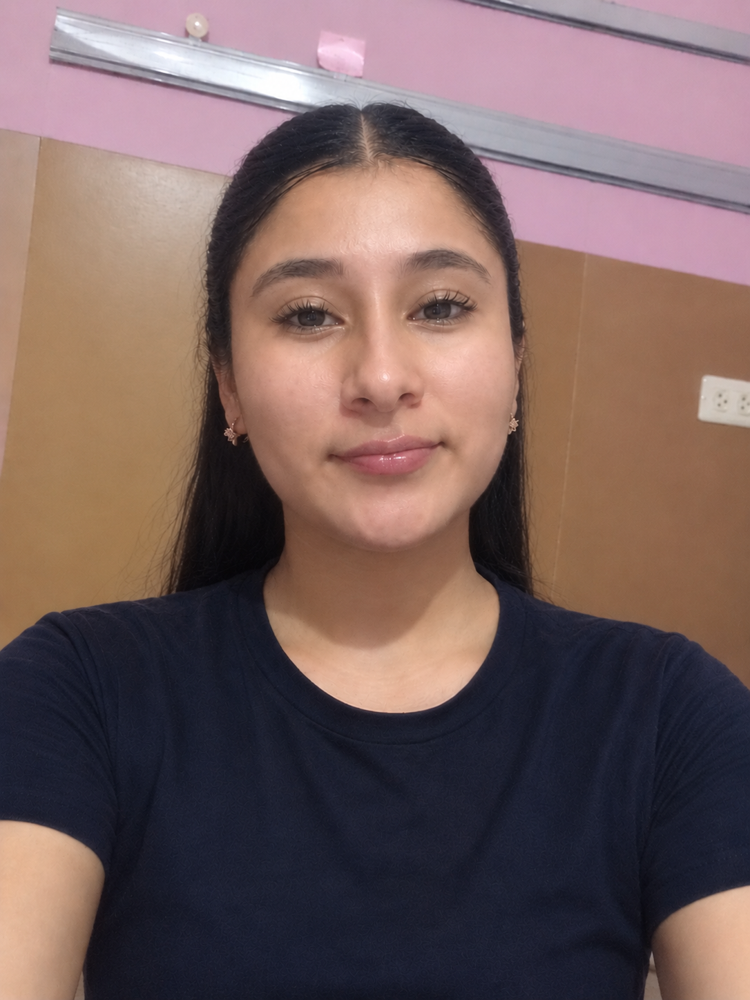

<!--
  PINK HACKER PROFILE | Lupita1605
  Ingeniería en Sistemas Computacionales
-->

<!-- BANNER PRINCIPAL -->

  

<!-- ANIMACIÓN -->

  

<!-- PRESENTACIÓN -->
<table>
<tr>
<td width="30%" align="center" valign="top">

<h3>Guadalupe Velázquez López</h3>

<strong>@Lupita1605</strong>

  

  

  

  

<em>Siempre aprendiendo ♡</em>

</td>

<td width="70%" valign="middle">

<h2>
  
  Sobre mí
</h2>

Soy estudiante de Ingeniería en Sistemas Computacionales, interesada en comprender cómo funcionan los sistemas y las tecnologías que hacen posible el mundo digital.

Me gusta aprender por mi cuenta, experimentar con diferentes herramientas y desarrollar soluciones mediante la programación.

Mis principales intereses son el **desarrollo de software, las bases de datos, las redes de computadoras y la ciberseguridad**.

Actualmente busco fortalecer mis conocimientos mediante la práctica, la experimentación y el aprendizaje continuo.

</td>
</tr>
</table>

 

<!-- TECNOLOGÍAS -->

  

  
  
  
  
  
  

  
  
  
  
  

  
  
  
  
  

 

<!-- ÁREAS DE INTERÉS -->

  

<!-- DESARROLLO -->
<h2>
  
  💻 Desarrollo de software
</h2>

Me interesa la creación de aplicaciones y sistemas, la lógica de programación y la resolución de problemas mediante código.

**Enfoques:**
- Desarrollo de aplicaciones y sistemas web.
- Programación orientada a objetos.
- Lógica y estructuras de datos.
- Integración entre aplicaciones y bases de datos.
- Diseño de soluciones mediante diferentes lenguajes de programación.

  
  
  
  

---

<!-- BASES DE DATOS -->
<h2>
  
  🗄️ Bases de datos
</h2>

Me interesa la organización, el almacenamiento y la administración de información, así como el diseño de bases de datos que permitan gestionar datos de manera eficiente.

**Enfoques:**
- Diseño de bases de datos relacionales.
- Modelado entidad-relación.
- Consultas SQL y manipulación de datos.
- Relaciones, restricciones y normalización.
- Administración y gestión de bases de datos.

  
  
  

---

<!-- REDES -->
<h2>
  
  🌐 Redes de computadoras
</h2>

Me interesa comprender cómo se comunican los dispositivos, cómo se construyen las redes y cómo se configura la infraestructura que permite la comunicación entre sistemas.

**Enfoques:**
- Modelos OSI y TCP/IP.
- Direccionamiento IPv4 y subnetting.
- Switching y routing.
- VLAN y segmentación de redes.
- Configuración de dispositivos Cisco.
- Diagnóstico y solución de problemas de conectividad.

  
  
  

---

<!-- CIBERSEGURIDAD -->
<h2>
  
  🔐 Ciberseguridad
</h2>

Es un área que me interesa explorar y desarrollar. Quiero aprender cómo proteger sistemas, identificar vulnerabilidades y comprender las amenazas que afectan a las redes y los dispositivos.

**Enfoques de aprendizaje:**
- Fundamentos de seguridad informática.
- Seguridad de redes.
- Seguridad en sistemas operativos.
- Análisis de vulnerabilidades.
- Hacking ético y prácticas de defensa.
- Protección de información y sistemas.

  
  
  

 

<!-- APRENDIZAJE -->

  

<table>
<tr>
<td width="50%" align="center">

### 🌐 Redes

Direccionamiento IP, subnetting, VLAN, routing y switching.

</td>
<td width="50%" align="center">

### 🐧 Linux y servidores

Administración de sistemas, terminal y servicios de red.

</td>
</tr>
<tr>
<td width="50%" align="center">

### ☁️ Computación en la nube

Fundamentos y servicios de Google Cloud.

</td>
<td width="50%" align="center">

### 🔐 Ciberseguridad

Seguridad de redes, sistemas y fundamentos de defensa.

</td>
</tr>
</table>

 

<!-- ESTADÍSTICAS -->

  

  
  

  

 

<!-- FOOTER -->

  

  

  <strong>Aprender · Experimentar · Crear</strong>
   
  <em>Building my own path in tech... ♡</em>

